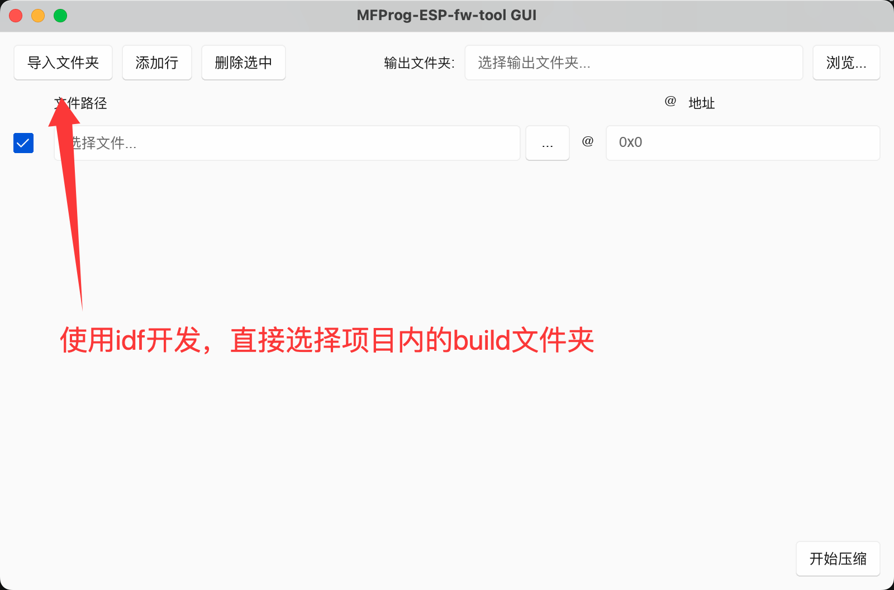
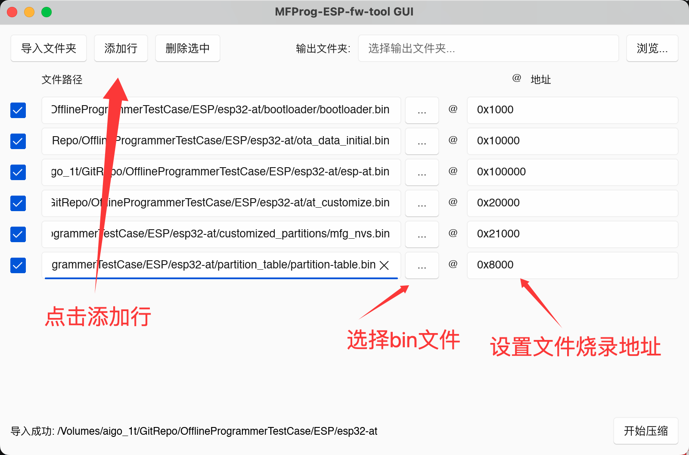
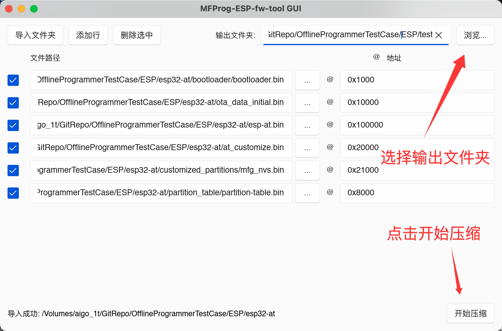
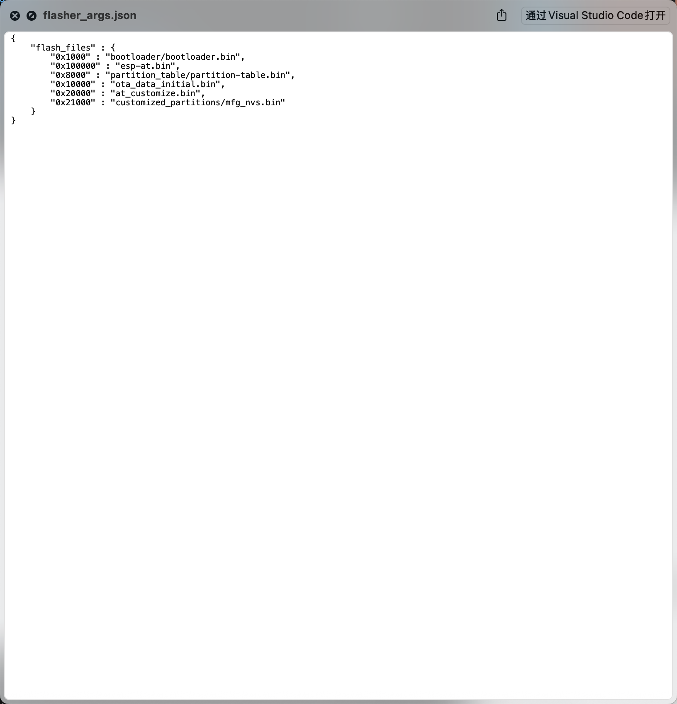
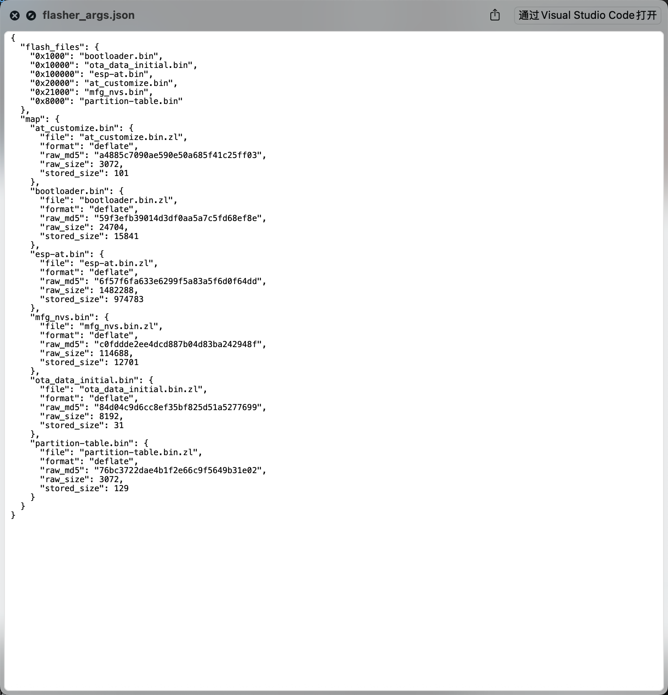
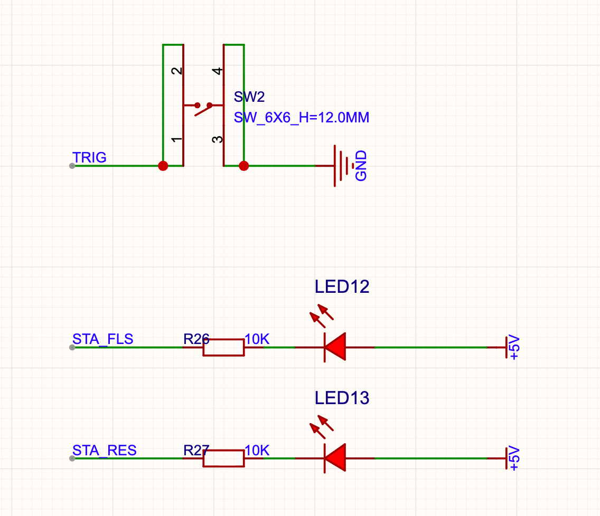

[中文](UserManual-MFProg_Lite_E0.md) | **English**

# MFProg Lite E0 User Manual

> A portable device for flashing firmware to ESP32 series chips.

---

## 1. Product Introduction

This device has 16 MB of built-in Flash space, of which about 11 MB can be used to store firmware.

### Key Features
- **Fully Offline Flashing**: Pre-store firmware on the device, then flash the ESP32 target board on-site without a computer.
- **Multi-Project Management**: Supports storing multiple different firmware projects, switch between them freely through the menu.
- **USB Drag-and-Drop Transfer**: Connect to a computer via Type-C cable and copy firmware files like a USB flash drive.
- **Compressed Accelerated Flashing**: Supports compressed firmware packages. The ESP32 decompresses and writes by itself, significantly shortening flashing time.
- **OTA Upgrade**: The device firmware itself can also be easily upgraded via USB drag-and-drop.

### Supported ESP Chips and Download Methods

- Supports ESP32, ESP32-C2, ESP32-C3, ESP32-C5, ESP32-C6, ESP32-C61, ESP32-H2, ESP32-P4, ESP32-S2, ESP32-S3, and ESP8266. More chips will be supported through OTA updates.
- Download based on ROM API (available but not yet open)
- Download based on stub after loading stub (larger single packet size, faster speed)
- Compressed firmware download based on stub after loading stub (pushes zlib-compressed firmware)
- Automatic flash encryption detection before flashing, preventing bricking caused by second download after encryption

---

## 2. Quick Start

### 2.1 Connect to Target Board

Use Dupont cables or a dedicated flashing cable to connect the device's flashing interface to the target ESP32 development board:

```
Flasher        Target ESP32 Board
------         ---------------
TX      ----->  RX
RX      ----->  TX
EN      ----->  EN
BOOT    ----->  GPIO0/9 etc. Check the manual for each ESP32
GND     ----->  GND
```

### 2.2 Power On

Power the device through the Type-C cable. The screen lights up and displays the boot screen, then automatically enters the main menu after about 2 seconds.

### 2.3 Main Menu Description

The main interface after booting has four options:
- **Flash** — Select a firmware project and start flashing
- **Files** — Browse stored firmware projects
- **U-Disk** — Enter U-disk mode to connect to computer for file transfer
- **Settings** — Adjust screen brightness, buzzer, language, etc.

Use **【Up】** and **【Down】** to move the cursor, and **【Confirm】** to enter the corresponding function.

---

## 3. Import ESP Firmware

To import ESP32 firmware from your computer into the flasher, follow these steps:

### 3.1 Enter U-Disk Mode

1. Select **【U-Disk】** in the main menu and press **【Confirm】** to enter.
2. After the screen prompts "U-disk mode enabled", connect the device to the computer with a Type-C cable.
3. The computer will recognize a removable disk (exactly the same as using a USB flash drive).

### 3.2 Firmware Package Generation

#### 3.2.1 Generate Compressed Firmware Package Using GUI Tool (Recommended)

If you develop with ESP-IDF, you can directly import the `build` folder for automatic recognition. The GUI tool can recognize required files through `flasher_args.json`.



If the firmware is provided by others and does not contain `flasher_args.json`, you can manually edit by adding rows and deleting selected items.



Then select the output folder and click "Start Compression" to generate the firmware package.



#### 3.2.2 Generate Compressed Firmware Package Using CLI Tool (Recommended for CI Scenarios)

```bash
MFProg-ESP-fw-tool -i <input_folder> -o <output_folder>
or
MFProg-ESP-fw-tool -i "[(0x0, bootloader.bin), (0x10000, app.bin)]" -o <output_folder>
```

#### 3.2.3 Manually Edit `flasher_args.json` (Not Recommended)

The tool itself can recognize the standard ESP-IDF output `flasher_args.json`. Just copy `flasher_args.json` and the mentioned files; extra parts in the JSON do not affect. If you need to write it yourself, a minimal JSON example is as follows. Note that this method does not enable compression.

```json
{
  "flash_files": {
    "0x0": "bootloader/bootloader.bin",
    "0x60000": "esp-at.bin",
    "0x8000": "partition_table/partition-table.bin",
    "0xd000": "ota_data_initial.bin",
    "0x1e000": "at_customize.bin",
    "0x1f000": "customized_partitions/mfg_nvs.bin"
  }
}
```

### 3.3 Copy the Generated Folder to U-Disk

A correct project format should look like this:


Non-compressed firmware JSON:



Compressed firmware JSON:



### 3.4 Safely Exit U-Disk Mode

1. Click "Eject" for the U-disk on the computer.
2. Long press **【Confirm】** on the device to exit U-disk mode, and the screen returns to the main menu.
3. Now you can see the newly imported project in the **【Files】** or **【Flash】** menu.

---

## 4. Use the Device to Flash

### 4.1 Select Project

1. Select **【Files】** in the main menu and press **【Confirm】** to enter.
2. The device will list all imported project folders.
3. Use **【Up】** / **【Down】** to select the `flasher_args.json` of the project you want to flash (highlighted in gold), and press **【Confirm】** to confirm.
4. After selection, it will automatically jump to the flashing page.

### 4.2 Flashing Process

During flashing, the screen displays in real time:
- **Stage Status**: such as "Connecting...", "Erasing...", "Writing...", "Verifying..."
- **Progress Bar**: shows the current overall flashing progress
- **Chip Info**: the identified target ESP32 chip model

Please keep the following during flashing:
- The connection between the device and target board is stable
- The target board is powered normally
- Do not press any buttons to interrupt flashing

### 4.3 Flashing Result

- **Success**: The screen displays "Flash Successful", and the buzzer plays a prompt tone (if enabled). Press **【Confirm】** to flash again, or long press to exit the page.
- **Failure**: The screen displays an error message (such as "Connection Timeout", "Verification Failed", etc.). You can troubleshoot based on this.

### 4.4 Machine Signal Interface

This device supports 3 GPIO signals to interface with automated flashing machines (fixtures), enabling an automated flashing process without manual intervention.

#### Input Trigger

- The `START` function is equivalent to the **【Confirm】** button on the device panel.
- A low-level pulse (falling edge) can trigger a single click operation, used by the machine to automatically start flashing.

#### Output Signal Timing

The machine can judge the current flashing status by reading the two output signals `STA_FLASH` and `STA_RES` (IO is open-drain output):

| Device Status | STA_FLASH | STA_RES |
|:---------|:----------------:|:-------------:|
| Idle/Standby | Release | Release |
| Flashing | Pull Low | Release |
| Flash Successful | Release | Pull Low |
| Flash Failed | Release | Release |

#### Machine Interface Example



---

## 5. System Settings

Select **【Settings】** in the main menu to adjust the following options:

| Setting Item | Description |
|--------|------|
| Buzzer | Turn operation prompt tone on/off |
| Language | Switch interface display language |
| BLE | Turn Bluetooth function on/off |
| Download Baud Rate | Set the download baud rate for ESP flashing (115200 / 460800 / 1000000 / 2000000) |

Operation:
- **【Up】** / **【Down】** to select setting item
- **【Confirm】** to enter edit mode
- In edit mode, **【Up】** / **【Down】** to switch option values
- Press **【Confirm】** again to save, or long press **【Confirm】** to return to the main menu

> **Tip**: The default download baud rate is **1000000**. If connection or verification errors occur frequently during flashing, try lowering the baud rate (such as 460800 or 115200).

---

## 6. Device OTA Upgrade (Device Firmware Upgrade)

When you need to update the flasher's own firmware or UI resources, use the UF2 upgrade method.

### 6.1 When to Upgrade?
- Official release of new features or bug fixes
- Need to update built-in UI images, fonts, and other resources

### 6.2 Enter Upgrade Mode

There are two ways to enter Bootloader upgrade mode:

**Method 1: Button Power On**
1. Disconnect the device power.
2. Press and hold the **【Confirm】（MID）** button.
3. Reconnect power (plug in Type-C cable).
4. Release the button after the screen displays the Bootloader screen.

**Method 2: App State Restart**
1. In normal boot state, long press the **【Confirm】（MID）** button on the home page.

After entering Bootloader, the device will be recognized by the computer as a removable disk named **MFProgBL**.

### 6.3 Perform Upgrade

1. Directly **drag and drop** the official `.uf2` upgrade file into the `MFProgBL` disk.
2. Wait for the file copy to complete, and the device will automatically flash.
3. After flashing is complete, the device automatically reboots and enters the new version system.

> **Important**: Do not power off or unplug the USB cable during the upgrade process, otherwise the device may fail to boot.

---

## 7. FAQ and Troubleshooting
