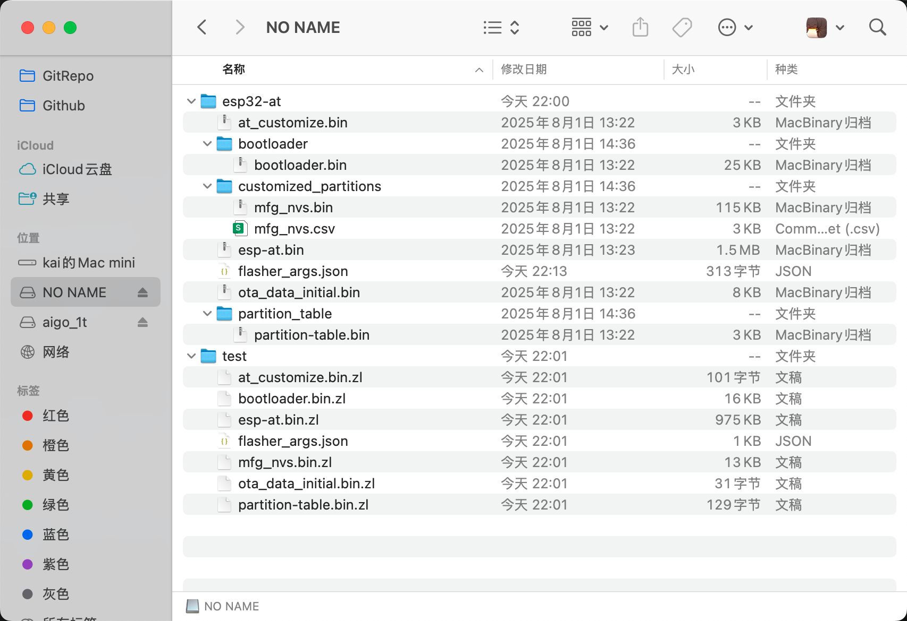

[中文](UserManual-MFProg_Lite_E0.md) | **English**

# MFProg Lite E0 User Manual

> A portable device for flashing firmware to ESP32 series chips.

---

## 1. Product Introduction

This device has 16 MB of built-in Flash space, of which about 11 MB can be used to store firmware.

### Key Features
- **Fully Offline Flashing**: Pre-store firmware on the device, then flash the ESP32 target board on-site without a computer.
- **Multi-Project Management**: Supports storing multiple different firmware projects, switch between them freely through the menu.
- **USB Drag-and-Drop Transfer**: Connect to a computer via Type-C cable and copy firmware files like a USB flash drive.
- **Compressed Accelerated Flashing**: Supports compressed firmware packages. The ESP32 decompresses and writes by itself, significantly shortening flashing time.
- **OTA Upgrade**: The device firmware itself can also be easily upgraded via USB drag-and-drop.

### Supported ESP Chips and Download Methods

- Supports ESP32, ESP32-C2, ESP32-C3, ESP32-C5, ESP32-C6, ESP32-C61, ESP32-H2, ESP32-H21, ESP32-H4, ESP32-P4, ESP32-S2, ESP32-S3, ESP32-S31, and ESP8266. More chips will be supported through OTA updates.
- Download based on ROM API (available but not yet open)
- Download based on stub after loading stub (larger single packet size, faster speed)
- Compressed firmware download based on stub after loading stub (pushes zlib-compressed firmware)
- Automatic flash encryption detection before flashing, preventing bricking caused by second download after encryption
- **eFuse Burning (Experimental)**: Burn eFuses (e.g. encryption keys, disabling download mode) according to the configuration in `flasher_args.json` while flashing firmware. See section 3.5.

---

## 2. Quick Start

### 2.1 Connect to Target Board

Use Dupont cables or a dedicated flashing cable to connect the device's flashing interface to the target ESP32 development board:

```
Flasher        Target ESP32 Board
------         ---------------
TX      ----->  RX
RX      ----->  TX
EN      ----->  EN
BOOT    ----->  GPIO0/9 etc. Check the manual for each ESP32
GND     ----->  GND
```

### 2.2 Power On

Power the device through the Type-C cable. The screen lights up and displays the boot screen, then automatically enters the main menu after about 2 seconds.

### 2.3 Main Menu Description

The main interface after booting has four options:
- **Flash** — Select a firmware project and start flashing
- **Files** — Browse stored firmware projects
- **U-Disk** — Enter U-disk mode to connect to computer for file transfer
- **Settings** — Adjust buzzer, language, download baud rate, etc.

Use **【Up】** and **【Down】** to move the cursor, and **【Confirm】** to enter the corresponding function.

---

## 3. Import ESP Firmware

To import ESP32 firmware from your computer into the flasher, follow these steps:

### 3.1 Enter U-Disk Mode

1. Select **【U-Disk】** in the main menu and press **【Confirm】** to enter.
2. After the screen prompts "U-disk mode enabled", connect the device to the computer with a Type-C cable.
3. The computer will recognize a removable disk (exactly the same as using a USB flash drive).

### 3.2 Firmware Package Generation

#### 3.2.1 Generate Compressed Firmware Package Using GUI Tool (Recommended)

If you develop with ESP-IDF, you can directly import the `build` folder for automatic recognition. The GUI tool can recognize required files through `flasher_args.json`.


If the firmware is provided by others and does not contain `flasher_args.json`, you can manually edit by adding rows and deleting selected items.


Then select the output folder and click "Start Compression" to generate the firmware package.


#### 3.2.2 Generate Compressed Firmware Package Using CLI Tool (Recommended for CI Scenarios)

```bash
MFProg-ESP-fw-tool -i <input_folder> -o <output_folder>
or
MFProg-ESP-fw-tool -i "[(0x0, bootloader.bin), (0x10000, app.bin)]" -o <output_folder>
```

#### 3.2.3 Manually Edit `flasher_args.json` (Not Recommended)

The tool itself can recognize the standard ESP-IDF output `flasher_args.json`. Just copy `flasher_args.json` and the mentioned files; extra parts in the JSON do not affect. If you need to write it yourself, a minimal JSON example is as follows. Note that this method does not enable compression.

```json
{
  "flash_files": {
    "0x0": "bootloader/bootloader.bin",
    "0x60000": "esp-at.bin",
    "0x8000": "partition_table/partition-table.bin",
    "0xd000": "ota_data_initial.bin",
    "0x1e000": "at_customize.bin",
    "0x1f000": "customized_partitions/mfg_nvs.bin"
  }
}
```

### 3.3 Copy the Generated Folder to U-Disk

A correct project format should look like this:



Non-compressed firmware JSON:


Compressed firmware JSON:


### 3.4 Safely Exit U-Disk Mode

1. Click "Eject" for the U-disk on the computer.
2. Long press **【Confirm】** on the device to exit U-disk mode, and the screen returns to the main menu.
3. Now you can see the newly imported project in the **【Files】** or **【Flash】** menu.

### 3.5 eFuse Burn Configuration (Experimental)

> **Warning**: eFuses are one-time programmable (OTP). Burning is **irreversible**, and an incorrect configuration can permanently render a chip unusable. This feature is experimental — validate it thoroughly on sacrificial boards before using it in production.

Add an optional `efuse` section to the project's `flasher_args.json` to burn eFuses together with the firmware:

```json
{
  "flash_files": {
    "0x0": "bootloader/bootloader.bin",
    "0x60000": "esp-at.bin"
  },
  "efuse": {
    "chips": ["esp32s3"],
    "burn": [
      {
        "block": "BLOCK_USR_DATA",
        "offset": 0,
        "data": "a1b2c3d4",
        "comment": "device config v3",
        "burn_after_flash": false
      }
    ]
  }
}
```

Field description:

| Field | Required | Description |
|------|------|------|
| `chips` | No | Chip model allowlist (e.g. `esp32s3`); burning is refused when the connected chip is not listed, preventing wrong-project mistakes |
| `burn` | Yes | Array of burn items |
| `block` | Yes | eFuse block name, same naming as espefuse (e.g. `BLOCK_USR_DATA`, `BLOCK_KEY0`, `BLOCK0`) |
| `data` | Yes | Hex string of the bits to set (OR semantics — other already-burned bits are unaffected); at most 36 bytes, length must be a multiple of 4 |
| `offset` | No | Byte offset inside the block (default 0, must be a multiple of 4) |
| `comment` | No | Remark text, shown in logs only |
| `burn_after_flash` | Yes | `false` = burn this item before writing flash; `true` = burn after flash is written and verified |

Notes:

- **No second confirmation**: in manual mode, selecting a project burns exactly what the configuration specifies — make sure the configuration is correct. The auto loop test (testdl) always skips eFuse burning.
- **Limited idempotency**: only for blocks that are not write-protected — an item whose requested bits are all already burned is skipped. Note that the device checks write protection **before** the already-burned check, so once a block is write-protected via `WR_DIS` (like the key block in the example below), re-burning the same project fails the write-protection check with an error. When re-flashing the same boards or updating firmware, remove the entire `efuse` section from the project package.
- Byte order matches `espefuse burn_block_data`: bytes `[4i..4i+3]` form block word `i` (little-endian).
- RS-coded blocks (all non-BLOCK0 blocks on ESP32-S2/S3/C3 and other newer chips) **do not allow appending to a non-empty block**; ESP32's 3/4-coded blocks are checked per 6-byte chunk. Write-protected blocks (WR_DIS) are refused with an error.
- The device enforces the burn order: non-BLOCK0 blocks first, then ordinary BLOCK0 fields, and protection/download-disabling fields always last.

> **Important BLOCK0 recommendation**: always set `"burn_after_flash": true` for BLOCK0 items (key purposes, `RD_DIS`/`WR_DIS` protection bits, `DIS_DOWNLOAD_MODE`, etc.). The enforced ordering only applies within a single burn phase and cannot protect across phases: if a BLOCK0 item burns before flash writing (`false`), its write-protect bits will make later items targeting those blocks fail, and download-disabling bits such as `DIS_DOWNLOAD_MODE` will cut the flashing channel before the firmware is even written.

- Converting field names / key files / key purposes into block bitmaps must be done on the host side (a converter in MFProg-ESP-fw-tool is planned); the device only performs block-level burning.
- ESP8266 does not support eFuse burning.

#### Example: Burning a Host-Pregenerated Flash Encryption Key (ESP32-S3)

This follows Espressif's official guide [Flash Encryption - Using a Host-generated Key](https://docs.espressif.com/projects/esp-idf/en/stable/esp32/security/flash-encryption.html#pregenerated-flash-encryption-key), using ESP32-S3 with AES-128 (256-bit key):

1. Generate the key file on a computer:

   ```bash
   idf.py secure-generate-flash-encryption-key my_flash_encryption_key.bin
   ```

2. **Byte-reverse** the key and convert it to a hex string (hardware byte-order requirement for XTS keys; espefuse `burn_key` does the same):

   ```bash
   $ python3 -c "print(open('my_flash_encryption_key.bin','rb').read()[::-1].hex())"
   dd26da7be1b5420d868969a06954d9343284497f39b7d23c307095b8bad91005
   ```

   (The original key file in this example contains `0510d9bab89570303cd2b7397f49843234d95469a06989860d42b5e17bda26dd` — for demonstration only, do not use it in a real product.)

3. Add the `efuse` section to the project's `flasher_args.json` (replace `data` with your own output from the previous step; the real demo value from this example is shown here):

   ```json
   {
     "flash_files": {
       "0x0": "bootloader/bootloader.bin",
       "0x8000": "partition_table/partition-table.bin",
       "0x10000": "app.bin"
     },
     "efuse": {
       "chips": ["esp32s3"],
       "burn": [
         {
           "block": "BLOCK_KEY0",
           "data": "dd26da7be1b5420d868969a06954d9343284497f39b7d23c307095b8bad91005",
           "comment": "flash encryption key (XTS_AES_128_KEY)",
           "burn_after_flash": false
         },
         {
           "block": "BLOCK0",
           "data": "000180000100000000000004000000000000000000000000",
           "comment": "KEY_PURPOSE_0=XTS_AES_128_KEY; WR_DIS[8] locks KEY_PURPOSE_0; WR_DIS[23]+RD_DIS[0] protect BLOCK_KEY0",
           "burn_after_flash": true
         }
       ]
     }
   }
   ```

   Meaning of the BLOCK0 bitmap (ESP32-S3): `KEY_PURPOSE_0 = 4` (XTS_AES_128_KEY) in word2, `WR_DIS` bit 8 in word0 (write-protects KEY_PURPOSE_0 itself, matching the official espefuse `burn_key` behavior), `WR_DIS` bit 23 in word0 (write-protects BLOCK_KEY0), and `RD_DIS` bit 0 in word1 (read-protects BLOCK_KEY0). The device automatically burns protection bits last.

4. In the ESP-IDF project, enable "Enable flash encryption on boot" via `menuconfig` → Security features, choose development or release mode, and rebuild.
5. Flash the project with this device as usual. On first boot, the bootloader encrypts the flash in place (may take about a minute for large partitions) — **do not power off during this process**.

> **This example follows the "key + plaintext firmware" flow**: firmware is written to flash as plaintext, and `SPI_BOOT_CRYPT_CNT` is set automatically by the bootloader during first-boot in-place encryption — that is why the bitmap above does not include it. Espressif also supports a "host pre-encrypted ciphertext" flow (pre-encrypting with `espsecure.py` and pre-burning `SPI_BOOT_CRYPT_CNT`), which targets raw-write channels such as gang programmers or JTAG — **do not flash `espsecure.py`-encrypted ciphertext with this device** (see below).
>
> **About re-flashing**: after first-boot encryption completes, re-flashing **plaintext** firmware with this device is safe — when the device detects flash encryption is enabled, it automatically switches to encrypted writes (plaintext is sent and encrypted on the chip with the burned key before writing, same as esptool). This requires 16-byte-aligned write addresses (32 bytes and stub mode for classic ESP32), and that neither `DIS_DOWNLOAD_MANUAL_ENCRYPT` (already burned → the device refuses with an error) nor download-disabling bits such as `DIS_DOWNLOAD_MODE` have been burned. **Do not** flash host-pre-encrypted ciphertext: the chip would encrypt the received data again, and double encryption makes the firmware unbootable.

> **ESP32 (classic) differences**: the flash encryption key block is `BLOCK1` (alias `flash_encryption`), and the same byte-reversal applies; if the chip's `CODING_SCHEME` is 3/4 (not the factory default, uncommon), the usable key block length is only 24 bytes.

> **Note**: the key exists in plaintext in the JSON stored on the device — keep project files safe. For production, generating a unique key per device is recommended.

---

## 4. Use the Device to Flash

### 4.1 Select Project

1. Select **【Files】** in the main menu and press **【Confirm】** to enter.
2. The device will list all imported project folders.
3. Use **【Up】** / **【Down】** to select the `flasher_args.json` of the project you want to flash (highlighted in gold), and press **【Confirm】** to confirm.
4. After selection, it will automatically jump to the flashing page.

### 4.2 Flashing Process

During flashing, the screen displays in real time:
- **Stage Status**: such as "Connecting...", "Erasing...", "Writing...", "Verifying..."
- **Progress Bar**: shows the current overall flashing progress
- **Chip Info**: the identified target ESP32 chip model

Please keep the following during flashing:
- The connection between the device and target board is stable
- The target board is powered normally
- Do not press any buttons to interrupt flashing

### 4.3 Flashing Result

- **Success**: The screen displays "Flash Successful", and the buzzer plays a prompt tone (if enabled). Press **【Confirm】** to flash again, or long press to exit the page.
- **Failure**: The screen displays an error message (such as "Connection Timeout", "Verification Failed", etc.). You can troubleshoot based on this.

### 4.4 Machine Signal Interface

This device supports 3 GPIO signals to interface with automated flashing machines (fixtures), enabling an automated flashing process without manual intervention.

#### Input Trigger

- The `START` function is equivalent to the **【Confirm】** button on the device panel.
- A low-level pulse (falling edge) can trigger a single click operation, used by the machine to automatically start flashing.

#### Output Signal Timing

The machine can judge the current flashing status by reading the two output signals `STA_FLASH` and `STA_RES` (IO is open-drain output):

| Device Status | STA_FLASH | STA_RES |
|:---------|:----------------:|:-------------:|
| Idle/Standby | Release | Release |
| Flashing | Pull Low | Release |
| Flash Successful | Release | Pull Low |
| Flash Failed | Release | Release |

#### Machine Interface Example


---

## 5. System Settings

Select **【Settings】** in the main menu to adjust the following options:

| Setting Item | Description |
|--------|------|
| Buzzer | Turn operation prompt tone on/off |
| Language | Switch interface display language (takes effect after the device automatically reboots when exiting the settings page) |
| BLE | Turn Bluetooth function on/off |
| Download Baud Rate | Set the download baud rate for ESP flashing (115200 / 460800 / 1000000 / 2000000) |
| Auto Enter Download | When enabled, the device automatically enters the flashing page on startup |
| BLE PIN | Shows the 4-digit PIN used for BLE connections (read-only) |
| Enter Bootloader | Reboot into Bootloader upgrade mode (see section 6) |

Operation:
- **【Up】** / **【Down】** to select setting item
- **【Confirm】** to enter edit mode
- In edit mode, **【Up】** / **【Down】** to switch option values
- Press **【Confirm】** again to save, or long press **【Confirm】** to return to the main menu

> **Note**: **【BLE PIN】** is read-only; **【Enter Bootloader】** is an action item — pressing **【Confirm】** immediately reboots the device into upgrade mode.

> **Tip**: The default download baud rate is **1000000**. If connection or verification errors occur frequently during flashing, try lowering the baud rate (such as 460800 or 115200).

---

## 6. Device OTA Upgrade (Device Firmware Upgrade)

When you need to update the flasher's own firmware or UI resources, use the UF2 upgrade method.

### 6.1 When to Upgrade?
- Official release of new features or bug fixes
- Need to update built-in UI images, fonts, and other resources

### 6.2 Enter Upgrade Mode

There are two ways to enter Bootloader upgrade mode:

**Method 1: Button Power On**
1. Disconnect the device power.
2. Press and hold the **【Confirm】（MID）** button.
3. Reconnect power (plug in Type-C cable).
4. Release the button after the screen displays the Bootloader screen.

**Method 2: Restart via Settings Page**
1. In normal boot state, enter the **【Settings】** page from the main menu.
2. Select **【Enter Bootloader】** and press **【Confirm】**.
3. The device automatically reboots into Bootloader mode.

After entering Bootloader, the device will be recognized by the computer as a removable disk named **MFProgBL**.

### 6.3 Perform Upgrade

1. Directly **drag and drop** the official `.uf2` upgrade file into the `MFProgBL` disk.
2. Wait for the file copy to complete, and the device will automatically flash.
3. After flashing is complete, the device automatically reboots and enters the new version system.

> **Important**: Do not power off or unplug the USB cable during the upgrade process, otherwise the device may fail to boot.

---

## 7. FAQ and Troubleshooting

### 7.1 Flashing Issues

**Q: "Connection Timeout" or chip not recognized?**
- Check whether TX/RX are swapped (flasher TX should connect to target board RX).
- Check that EN, BOOT, and GND connections are secure.
- Make sure the target board is powered normally.
- Lower the download baud rate to 460800 or 115200 in **【Settings】** and try again.

**Q: "Verification Failed"?**
- Usually caused by unstable communication. Lower the download baud rate, shorten the wiring, and try again.
- If the target chip already has flash encryption enabled, the device automatically switches to encrypted-write mode and re-flashing plaintext firmware is still safe; only when the chip has protection bits such as `DIS_DOWNLOAD_MANUAL_ENCRYPT` burned (production-disabled encrypted download) will the device refuse to flash and report an error — this is normal brick-prevention protection.

**Q: Unsupported chip model reported?**
- Confirm the chip is in the supported list (see section 1). Some newer chip models require newer device firmware — upgrade the device first as described in section 6.

### 7.2 File and U-Disk Issues

**Q: Computer does not recognize the U-disk?**
- Make sure you have entered **【U-Disk】** mode from the main menu, and use a Type-C cable that supports data transfer (some cables are charge-only).

**Q: Project does not appear after copying, or files are corrupted?**
- Eject the U-disk on the computer first, then long press **【Confirm】** on the device to exit U-disk mode, ensuring data is fully written before unplugging.

### 7.3 System and Upgrade Issues

**Q: Interface did not change after switching language?**
- The language setting takes effect after a reboot. When you long press **【Confirm】** to exit the settings page, the device automatically reboots and applies the new language.

**Q: How to enter Bootloader upgrade mode?**
- Power on while holding the **【Confirm】（MID）** button, or select **【Enter Bootloader】** in **【Settings】**. See section 6.

**Q: Device cannot boot after an interrupted upgrade?**
- Power on again while holding the **【Confirm】（MID）** button to enter Bootloader, then drag a complete `.uf2` upgrade file into the `MFProgBL` disk to recover.
