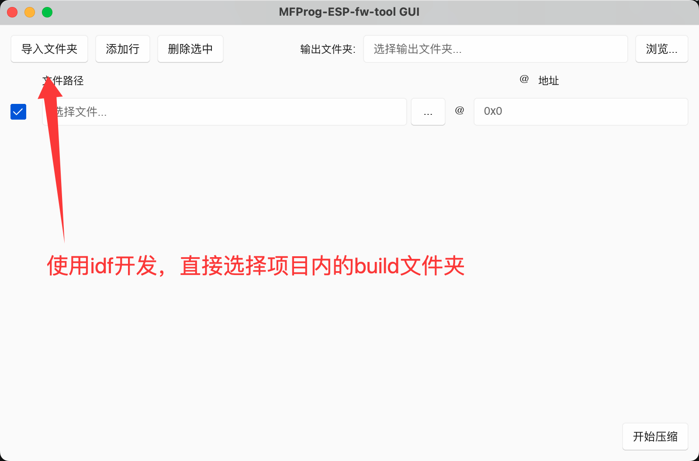
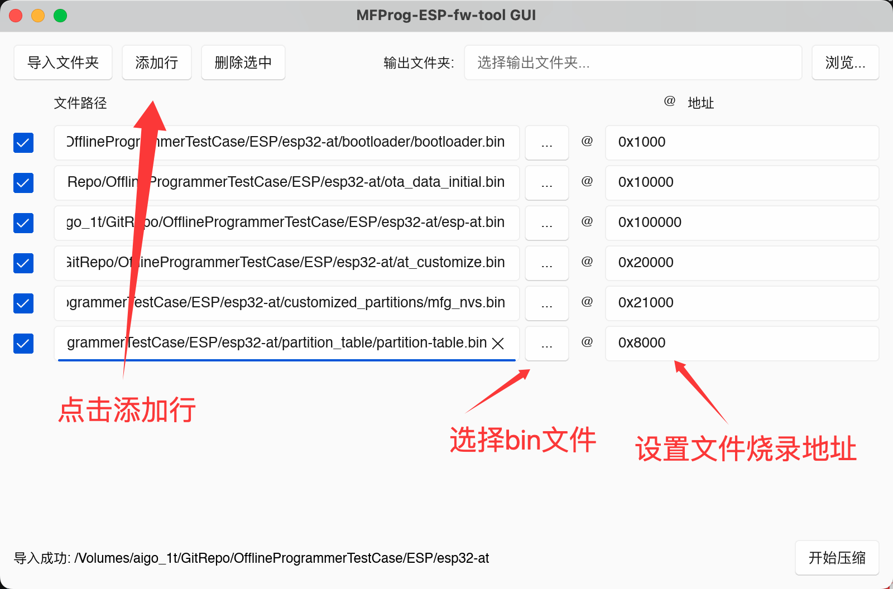
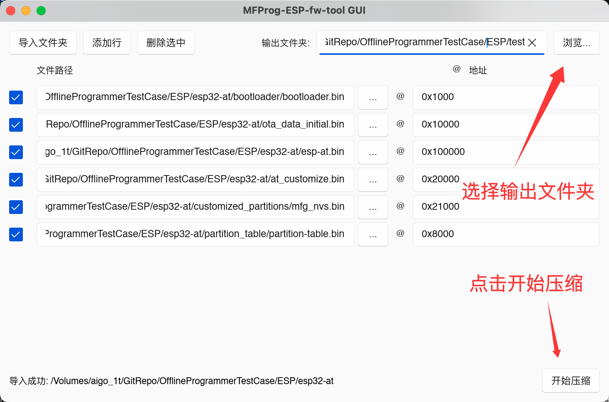
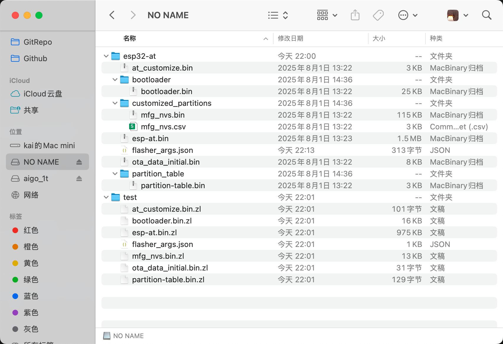
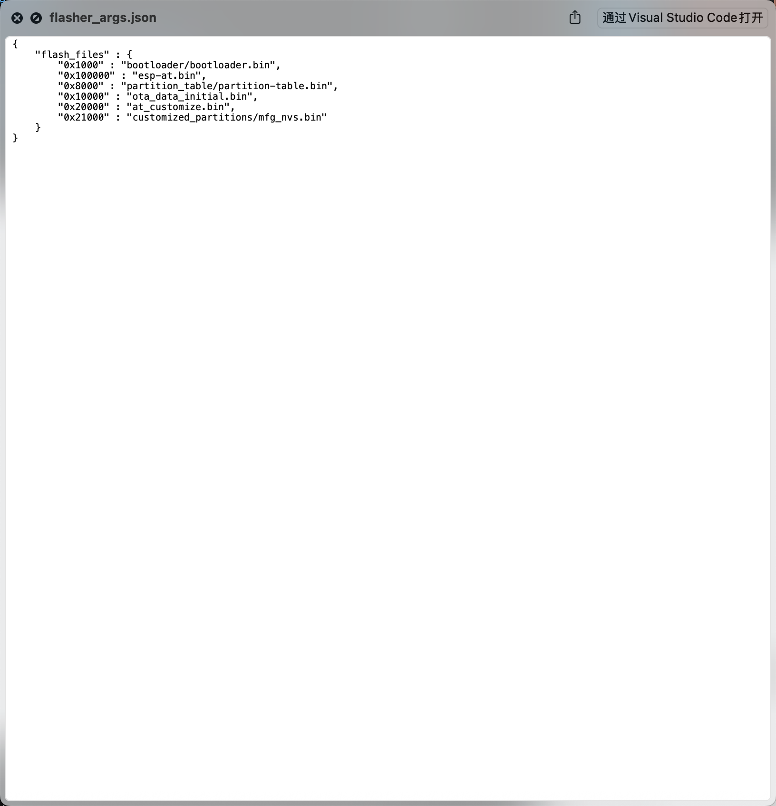
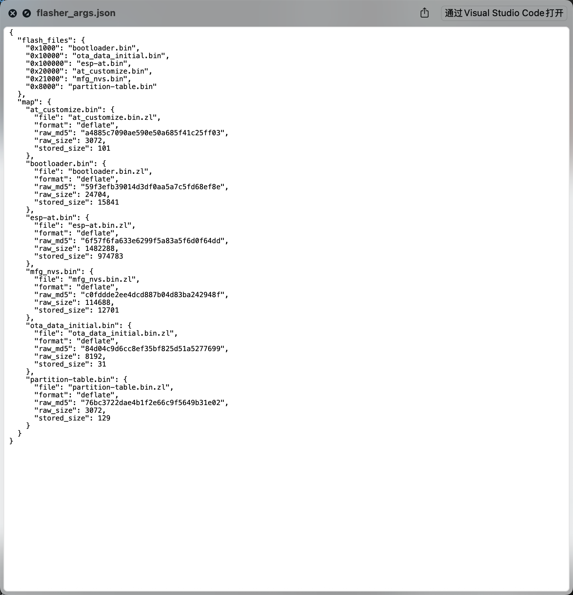
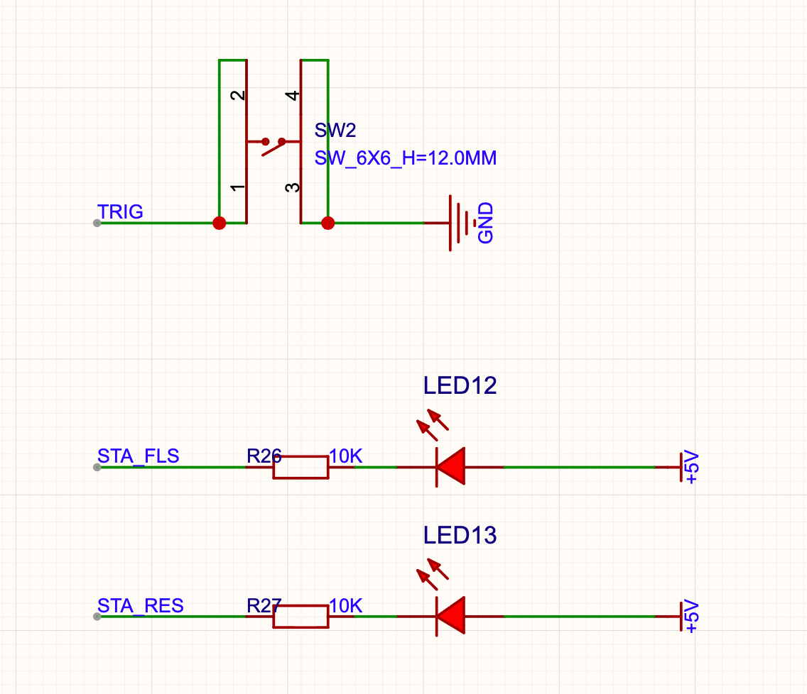

# MFProg Lite E0 使用说明书

> 一款适用于 ESP32 系列芯片烧录固件的便携设备。

---

## 1. 产品简介

本设备内置 16MB Flash空间，其中约 11MB 可用于存放固件。

### 核心功能
- **完全离线烧录**：预先将固件存入设备，现场直接对 ESP32 目标板进行烧录，无需电脑参与。
- **多项目管理**：支持存放多组不同的固件项目，通过菜单自由切换选择。
- **USB 拖拽传输**：通过 Type-C 线连接电脑，像操作 U 盘一样拷贝固件文件。
- **压缩加速烧录**：支持压缩固件包，由 ESP32 自行解压写入，大幅缩短烧录时间。
- **OTA 升级**：设备自身固件也可通过 USB 拖拽方式轻松升级。

### 支持的ESP和下载方式

- 支持 ESP32 ESP32-C2 ESP32-C3 ESP32-C5 ESP32-C6 ESP32-C61 ESP32-H2 ESP32-P4 ESP32-S2 ESP32-S3 ESP8266， 随着OTA来支持更多的芯片。
- 基于rom api的下载（可用但暂为开放）
- 加载stub后基于stub的下载（更大的单包大小，更快的速度）
- 加载stub后基于stub的压缩固件下载（推送zlib压缩后的固件）
- 烧录前自动识别flash加密，防止加密后二次下载导致的变砖

---

## 2. 快速开始

### 2.1 连接目标板

使用杜邦线或专用烧录线，将设备的烧录接口与目标 ESP32 开发板连接：

```
烧录器          目标 ESP32 板
------          ---------------
TX      ----->   RX
RX      ----->   TX
EN      ----->   EN 
BOOT    ----->   GPIO0/9等，具体查看各ESP32的手册
GND     ----->   GND
```

### 2.2 开机

通过 Type-C 线给设备供电，屏幕亮起后显示启动画面，约 2 秒后自动进入主菜单。

### 2.3 主菜单说明

开机后看到的主界面有四个选项：
- **烧录** —— 选择固件项目并开始烧录
- **文件** —— 浏览已存储的固件项目
- **U盘** —— 进入 U 盘模式，连接电脑传输文件
- **设置** —— 调整屏幕亮度、蜂鸣器、语言等

使用 **【上】** 和 **【下】** 键移动光标，**【确认】** 键进入对应功能。

---

## 3. 导入 ESP 固件

要将电脑上的 ESP32 固件导入到烧录器中，请按以下步骤操作：

### 3.1 进入 U 盘模式

1. 在主菜单选择 **【U盘】**，按 **【确认】** 键进入。
2. 屏幕提示 "U盘模式已开启" 后，用 Type-C 线将设备连接到电脑。
3. 电脑会识别出一个可移动磁盘（与 U 盘使用方式完全相同）。

### 3.2 固件包生成

#### 3.2.1 使用 GUI 工具进行压缩固件包生成（推荐）

如果你使用 ESP-IDF 开发，直接导入build文件夹即可自动识别。gui工具能通过`flasher_args.json`识别所需文件。



如果是别人提供的固件，内不包含`flasher_args.json`，可以通过添加行和删除选中进行手动编辑



然后选择输出文件夹，点击开始压缩即可生成固件包。



#### 3.2.2 使用 CLI 工具进行压缩固件包生成（CI场景推荐）

```bash
MFProg-ESP-fw-tool -i <input_folder> -o <output_folder>
或
MFProg-ESP-fw-tool -i "[(0x0, bootloader.bin), (0x10000, app.bin)]" -o <output_folder>
```

#### 3.2.3 手动编辑`flasher_args.json`（不推荐）

工具本身可识别标准的idf输出的`flasher_args.json`。拷贝`flasher_args.json`及提到的文件即可，json多余的部分不影响。如需自行编写，一个最简的json示例如下。需要注意，此方式并不会启用压缩。

```json
{
  "flash_files": {
    "0x0": "bootloader/bootloader.bin",
    "0x60000": "esp-at.bin",
    "0x8000": "partition_table/partition-table.bin",
    "0xd000": "ota_data_initial.bin",
    "0x1e000": "at_customize.bin",
    "0x1f000": "customized_partitions/mfg_nvs.bin"
  }
}
```

### 3.3 拷贝生成的文件夹到U盘

一个正确的项目格式应该如下



非压缩固件json



压缩固件json



### 3.4 安全退出 U 盘模式

1. 在电脑上点击"弹出/推出 U 盘"。
2. 在设备上长按 **【确认】** 键退出 U 盘模式，屏幕返回主菜单。
3. 现在你可以在 **【文件】** 或 **【烧录】** 菜单中看到刚刚导入的项目了。

---

## 4. 使用设备烧录

### 4.1 选择项目

1. 在主菜单选择 **【文件】**，按 **【确认】** 进入。
2. 设备会列出所有已导入的项目文件夹。
3. 使用 **【上】** / **【下】** 选择你要烧录的项目的`flasher_args.json`（已使用金色标注），按 **【确认】** 确认。
4. 选择后会自动跳转到烧录页面

### 4.2 烧录过程

烧录过程中屏幕会实时显示：
- **阶段状态**：如 "连接中..."、"擦除中..."、"写入中..."、"校验中..."
- **进度条**：显示当前总体烧录进度
- **芯片信息**：识别到的目标 ESP32 芯片型号

此时请保持：
- 设备与目标板的连接线稳固
- 目标板上电正常
- 不要按任何按键中断烧录

### 4.3 烧录结果

- **成功**：屏幕显示 "烧录成功"，蜂鸣器播放提示音（如已开启）。按 **【确认】** 再次烧录，长按退出页面。
- **失败**：屏幕显示错误信息（如 "连接超时"、"校验失败" 等）。可据此检查问题。

### 4.4 机台信号接口

本设备支持 3 路 GPIO 信号与自动化烧录机台（治具）对接，实现免人工干预的自动烧录流程。

#### 输入触发

- `START` 功能等价于设备面板上的 **【确认】** 键。
- 低电平脉冲（下降沿）即可触发一次单击操作，用于机台自动开始烧录。

#### 输出信号时序

机台可通过读取 `STA_FLASH` 和 `STA_RES` 两路输出判断当前烧录状态（IO为开漏输出）：

| 设备状态 | STA_FLASH | STA_RES |
|:---------|:----------------:|:-------------:|
| 空闲/待机 | 释放 | 释放 |
| 烧录中 | 拉低 | 释放 |
| 烧录成功 | 释放 | 拉低 |
| 烧录失败 | 释放 | 释放 |

#### 机台对接示例



---

## 5. 系统设置

在主菜单选择 **【设置】** 可以调整以下选项：

| 设置项 | 说明 |
|--------|------|
| 蜂鸣器 | 开启/关闭操作提示音 |
| 语言 | 切换界面显示语言 |
| BLE | 开启/关闭蓝牙功能 |
| 下载波特率 | 设置 ESP 烧录时的下载波特率（115200 / 460800 / 1000000 / 2000000） |

操作方式：
- **【上】** / **【下】** 选择设置项
- **【确认】** 进入编辑模式
- 编辑模式下 **【上】** / **【下】** 切换选项值
- 再次按 **【确认】** 保存，或长按 **【确认】** 返回主菜单

> **提示**：下载波特率默认值为 **1000000**。若烧录时频繁出现连接或校验错误，可尝试降低波特率（如 460800 或 115200）。

---

## 6. 设备 OTA 升级（本机固件升级）

当需要更新烧录器自身的固件或 UI 资源时，使用 UF2 升级方式。

### 6.1 何时需要升级？
- 官方发布了新功能或问题修复
- 需要更新内置的 UI 图片、字体等资源

### 6.2 进入升级模式

有两种方式进入 Bootloader 升级模式：

**方式一：按键上电**
1. 断开设备电源。
2. 按住 **【确认】（MID）** 键不放。
3. 重新连接电源（插入 Type-C 线）。
4. 屏幕显示 Bootloader 画面后松开按键。

**方式二：app态重启**
1. 在正常开机状态下在主页长按**【确认】（MID）** 键

进入 Bootloader 后，设备会被电脑识别为一个名为 **MFProgBL** 的可移动磁盘。

### 6.3 执行升级

1. 将官方提供的 `.uf2` 升级文件直接**拖拽**到 `MFProgBL` 磁盘中。
2. 等待文件复制完成，设备会自动进行烧录。
3. 烧录完成后设备自动重启，进入新版本的系统。

> **重要**：升级过程中请勿断电或拔出 USB 线，否则可能导致设备无法启动。

---

## 7. 常见问题与故障排除


